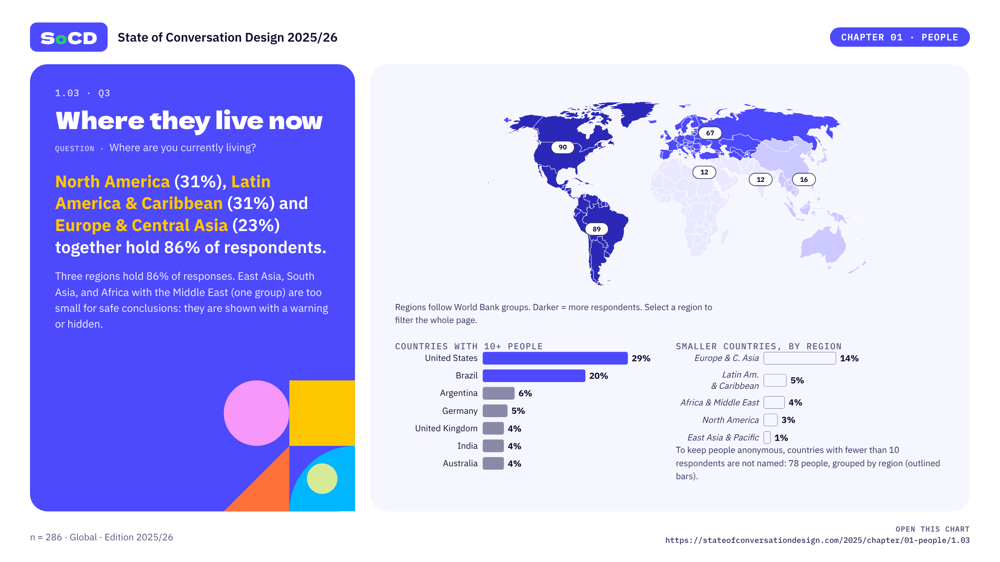
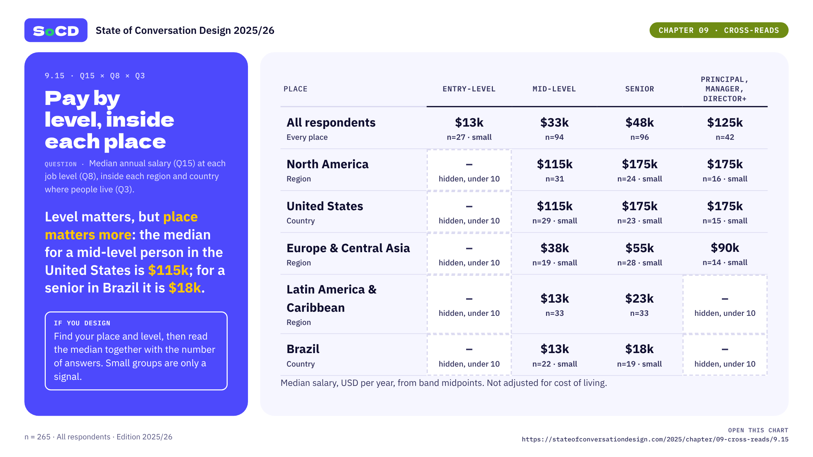
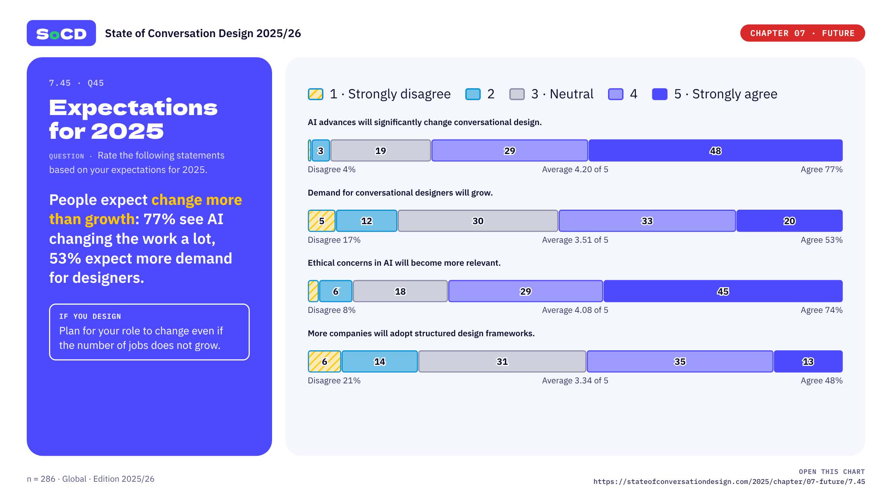

# State of Conversation Design 2025/26: open data

The anonymized data behind the **State of Conversation Design** report, an annual global survey of the people who design conversations.

- **286 respondents** from every world region, collected from January to April 2025.
- Full report: https://stateofconversationdesign.com/
- Data version: **1.0** (2026-11-26).

## What is here

| File | Use it for |
|---|---|
| `data/SoCD26_public.xlsx` | The easy way. Open in Excel or Google Sheets. The `responses` sheet has one row per person and one column per question, like the survey export; `results` and `highlights` have the totals. |
| `data/csv/` | The same tables as CSV files, one per table. Good for any tool. |
| `data/SoCD26_public.sqlite` | The same data as a database, for SQL or code. |
| `data/README.md` | Data notes: every table and column, how open answers were classified, what was removed for privacy. |
| `ANALYZE_WITH_CLAUDE.md` | A ready prompt: the AI downloads the data, draws three starter charts and explores with you. |
| `report/REPORT_MAP.md` | Map of the published report: every finding, chart, chapter and archetype, with a summary and a link. Also as `report_index.json`. |
| `skill/socd-open-data/` | The same prompt, as a Claude skill. |
| `images/` | Three charts exported from the official report. |
| `brand/` | Logo, fonts, colors and chart layout of the report (`BRAND.md`), so new charts look like the report. |

## A first look

Three charts from the [official report](https://stateofconversationdesign.com/2025/), made with this data. Click a chart to open it in the report. The prompt below asks an AI assistant to build its own versions in the same style, then explore with you.

## Analyze it with AI

1. Copy the prompt in [`ANALYZE_WITH_CLAUDE.md`](ANALYZE_WITH_CLAUDE.md).
2. Paste it into Claude or another AI assistant that can open web links. It downloads the data from this repository by itself, builds the three charts above and uses the report map to link its answers to the published report.
3. Ask your own questions from there.

Using Claude often? Add the skill in [`skill/socd-open-data`](skill/socd-open-data) to your Claude account: it carries the data links, the rules and the report's style, so you only need to ask.

## Good practice

- Always report how many people are behind a number (`n`).
- Do not draw conclusions about groups with fewer than 10 people.
- A correlation is not a cause.
- This is a self-selected sample, reached through communities and an ambassador network. It describes the people who answered, not every conversation designer.
- Do not try to identify anyone. Many people have a unique combination of answers, so respondent-level data can never be fully anonymous.

## License and citation

Data released under [Creative Commons Attribution 4.0 (CC BY 4.0)](https://creativecommons.org/licenses/by/4.0/). You can share and adapt it, also commercially, as long as you credit the source.

Suggested citation:

> State of Conversation Design 2025/26, open data v1.0. https://stateofconversationdesign.com/

## Questions or corrections

Use the feedback on the report site, or open an issue in this repository.
